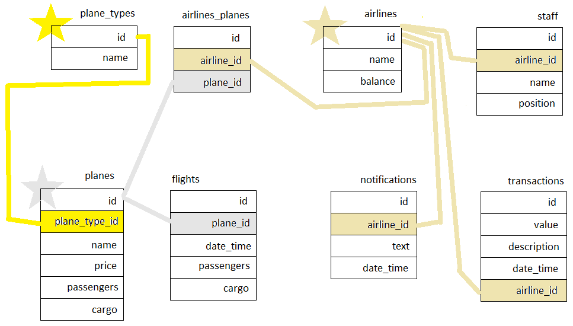

BEFORE USING APP (Python 3.10+):

- Install dependencies:
  `pip install -r requirements.txt`

- Run Web UI (Flask 3):
  `flask --app src/webui run`
  (or from `src/`: `flask --app webui run`, or `python3 src/webui.py`)

- Run CLI:
  `python3 src/cli.py -m` (manager mode)
  `python3 src/cli.py -d` (dispatcher mode)

- Run tests:
  `python3 -m unittest discover -s src`
  (or from `src/`: `python3 -m unittest tests`)

-- СХЕМА БД --

